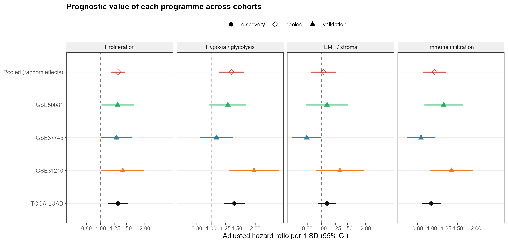
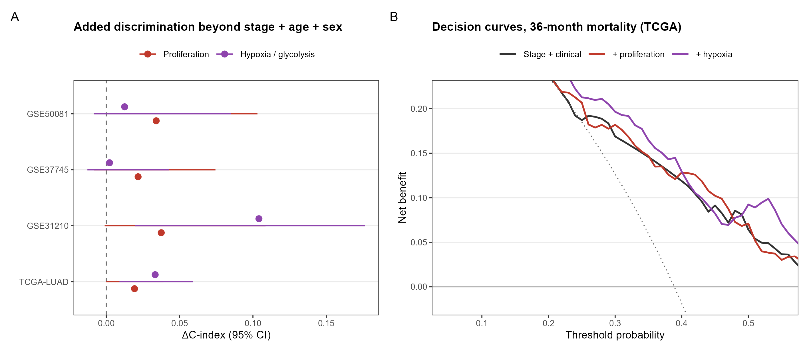
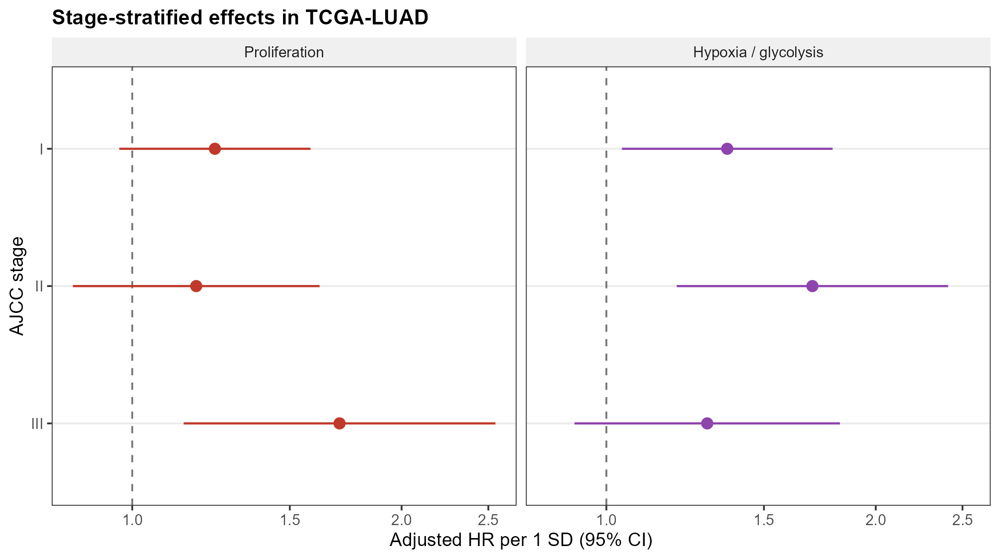
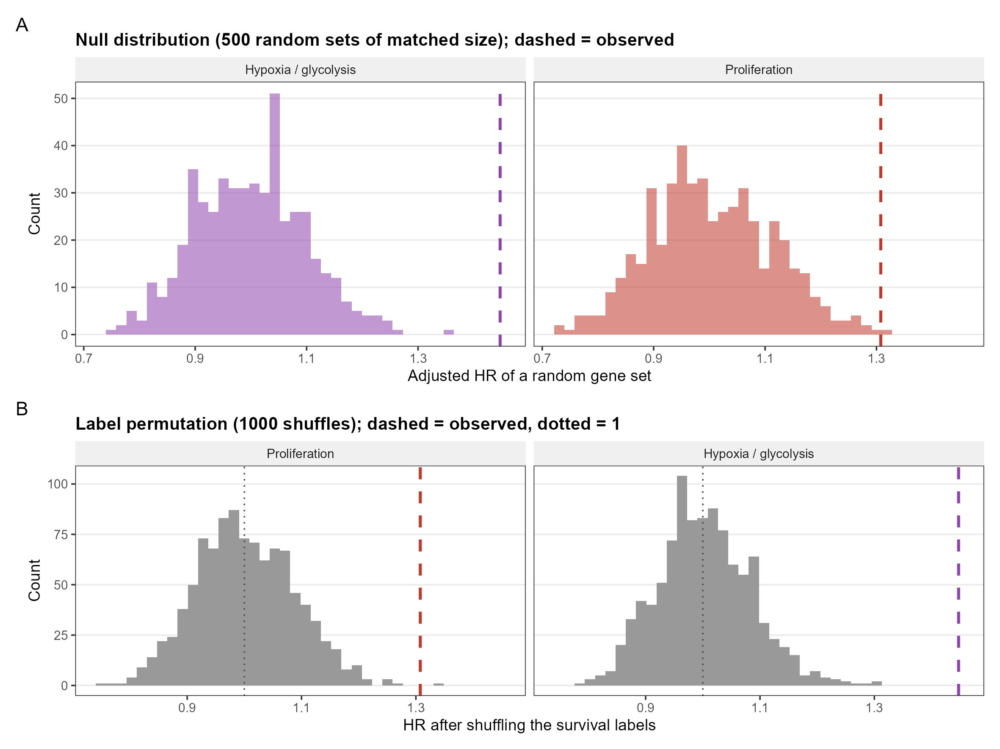
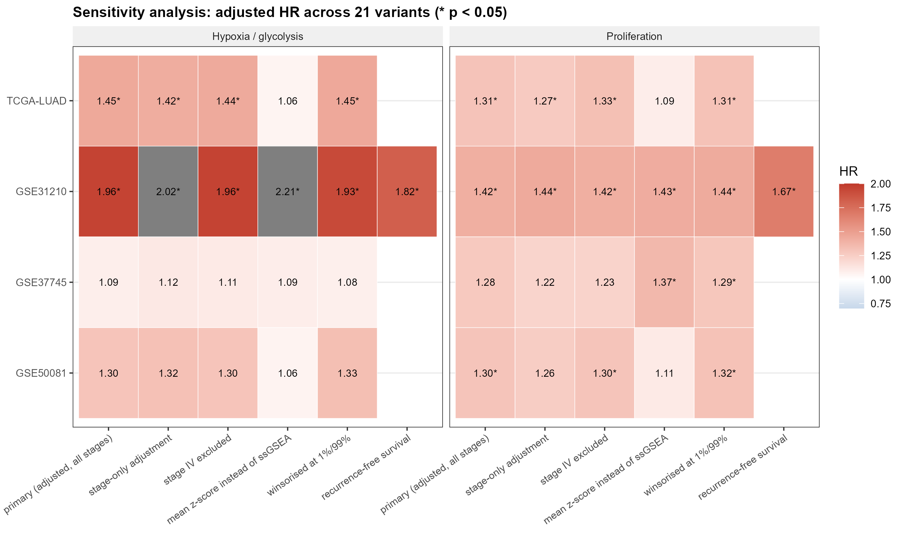

# Prognostic value of four tumour transcriptional programmes in lung adenocarcinoma

**A pre-specified, multi-cohort study.** Four Hallmark programmes (proliferation, hypoxia/glycolysis,
EMT/stroma, immune infiltration) are scored by ssGSEA in TCGA-LUAD (n = 515) and validated in three
independent GEO cohorts (n = 437). Only **proliferation** replicates consistently (pooled HR 1.32,
95% CI 1.13–1.54, I² = 0%); it adds a **modest** ΔC-index of +0.02–0.03 beyond stage. The immune
infiltration score shows no prognostic value in any cohort — reported as a negative result.

---

## 研究问题

肺腺癌的预后主要依据 TNM 分期，但同一分期的病人结局差异很大。转录组能否在分期之外提供额外信息？
如果能，补上这部分信息的是**哪一类**生物学程序？

这个问题被拆成四个可证伪的假设：

| 假设 | 判据 | 结果 |
|---|---|---|
| H1 四个程序都能被稳定量化 | 真实基因集在同大小随机基因集的零分布中的位置 | 通过（z = +6 至 +22） |
| H2 至少一个程序独立于分期预测生存 | 校正分期/年龄/性别后 HR 的 95% CI 不跨 1 | 通过（增殖、缺氧） |
| H3 该关联能在独立队列中复现 | ≥3 个外部队列方向一致且合并后显著 | 仅增殖通过 |
| H4 在分期之外有增量判别能力 | ΔC-index > 0 且似然比检验显著 | 通过，但幅度有限（+0.02–0.03） |

---

## 数据

| 队列 | 角色 | 平台 | 样本 | 死亡事件 | 中位 OS |
|---|---|---|---|---|---|
| [TCGA-LUAD](https://portal.gdc.cancer.gov/projects/TCGA-LUAD) | 发现 | Illumina RNA-seq（STAR counts） | 515 | 185 | 22.0 月 |
| [GSE31210](https://www.ncbi.nlm.nih.gov/geo/query/acc.cgi?acc=GSE31210) | 验证 | Affymetrix HG-U133 Plus 2.0 | 204 | 30 | 59.6 月 |
| [GSE37745](https://www.ncbi.nlm.nih.gov/geo/query/acc.cgi?acc=GSE37745) | 验证 | Affymetrix HG-U133 Plus 2.0 | 106 | 77 | 47.8 月 |
| [GSE50081](https://www.ncbi.nlm.nih.gov/geo/query/acc.cgi?acc=GSE50081) | 验证 | Affymetrix HG-U133 Plus 2.0 | 127 | 51 | 52.4 月 |

- 外部队列全部限定为**腺癌**组织学（GSE37745 / GSE50081 原本是混合组织学 NSCLC）。
- 515 例是可用生存信息的队列规模；多因素模型用**完整病例**（497 例 / 180 例死亡）。
- GSE72094（442 例）被**主动排除**：自定义 HuRSTA 芯片无可用注释包，探针无法映射到基因符号。
  详见 [`docs/data_provenance.md`](docs/data_provenance.md)。

---

## 方法

1. **表达处理**：TCGA 的 STAR counts → `log2(count+1)`；芯片用平台注释映射探针到基因符号，
   重复基因保留平均表达最高的一行。所有队列统一为基因符号 × 样本的 log2 矩阵。
2. **打分**：每个 Hallmark 基因集做 **ssGSEA**（Barbie 2009，α = 0.25）；程序得分 = 成员基因集
   队列内 z 分数的平均，再整体 z 标准化（队列内均值 0 / 标准差 1）。
3. **主模型**：`Surv(OS, 死亡) ~ 程序评分 + 分期 + 年龄 + 性别` 的 Cox 模型，报告每 **1 SD** 的 HR。
4. **合并**：DerSimonian–Laird 随机效应模型，报告合并 HR、I²、τ²。
5. **增量价值**：C-index（bootstrap 95% CI）、似然比检验、连续 NRI、36 个月决策曲线。
6. **阴性对照**：同大小随机基因集 ×500、生存标签置换 ×1000。
7. **敏感性**：21 种变体（换评分方法、换协变量、排除 IV 期、缩尾、改用无复发生存等）。

分析计划在读取任何外部队列之前定稿：[`docs/analysis_plan.md`](docs/analysis_plan.md)。

---

## 主要结果

### 1. 跨队列的可复制性

每 1 SD 的校正 HR：

| 程序 | TCGA-LUAD | GSE31210 | GSE37745 | GSE50081 | 合并（3 个验证队列） | I² |
|---|---|---|---|---|---|---|
| **增殖** | 1.31 (1.12–1.54) | 1.42 (1.01–1.98) | 1.28 (1.00–1.64) | 1.30 (1.01–1.68) | **1.32 (1.13–1.54)**, p = 5.7×10⁻⁴ | **0%** |
| 缺氧/糖酵解 | 1.44 (1.22–1.71) | 1.96 (1.33–2.90) | 1.09 (0.84–1.41) | 1.30 (0.98–1.74) | 1.37 (1.00–1.86), p = 0.049 | 67% |
| EMT/间质 | 1.09 (0.95–1.26) | 1.33 (0.91–1.96) | 0.79 (0.63–1.00) | 1.09 (0.78–1.52) | 1.02 (0.75–1.39), p = 0.91 | 67% |
| 免疫浸润 | 0.99 (0.86–1.15) | 1.36 (0.97–1.90) | 0.84 (0.67–1.06) | 1.20 (0.89–1.63) | 1.09 (0.81–1.48), p = 0.56 | 70% |

增殖程序四个队列 HR 全部 > 1、合并异质性为 0；免疫浸润方向来回翻转、异质性 70%。



### 2. 分期之外的增量价值

| 程序 | TCGA ΔC-index | 三个验证队列 | 似然比检验 |
|---|---|---|---|
| 增殖 | +0.019 (0.000, 0.039) | +0.037 / +0.022 / +0.034（均值 +0.031） | 4 个队列全部 p < 0.05 |
| 缺氧 | +0.033 (0.009, 0.059) | +0.104 / +0.002 / +0.013 | 异质，2 个队列 p < 0.05 |

分期 + 年龄 + 性别的 C-index 是 0.667，加增殖评分后 0.686。提升真实、可复现，但不大。



### 3. 分期分层（探索性）

- 增殖：III 期 HR 1.70 (1.14–2.55)，I/II 期不显著。
- 缺氧：**I 期 HR 1.36 (1.04–1.79)、II 期 HR 1.70 (1.20–2.41)**。



### 4. 稳健性

- 随机基因集 ×500：TCGA 中增殖的观测 HR 1.31 落在零分布 99 分位（1.26）之外，经验 p = 0.004；缺氧 p = 0.002。
- 标签置换 ×1000：p = 0.002 / 0.001。
- 敏感性 21 个变体：两个程序 HR **全部 > 1**（方向从未翻转）。唯一明显不一致的是
  「平均表达量代替 ssGSEA」（1.09 / 1.06，不显著）——说明结论依赖收敛秩的富集评分。




### 5. 一个被否定的假设

项目最初考察「增殖 − 免疫」平衡（`z(增殖) − z(免疫)`）。数据不支持：平衡评分本身显著
（HR 1.21, 1.04–1.42），但**增殖 × 免疫交互项 p = 0.92**，免疫评分单独看 HR 0.99（p = 0.91）。
因此改为四个程序的正面对比。经过与时间戳见 [`docs/changelog.md`](docs/changelog.md)。

---

## 局限

- **没有校正肿瘤纯度**：增殖评分部分反映肿瘤细胞比例；用 EMT/免疫评分做过间接控制，但那不是纯度校正。
- **没有免疫治疗数据**：终点是总生存，不能声称能预测 ICI 获益。
- **外部验证全是芯片平台**：跨平台只有 TCGA → 芯片 一个方向。
- **结论依赖评分方法**：平均表达量代替 ssGSEA 时效应消失。
- **功效限制**：GSE31210 只有 30 个死亡事件，其阴性结果主要是功效不足。

完整清单见 [`docs/limitations.md`](docs/limitations.md)。

---

## 仓库结构

```
R/
  00_setup.R              设计与参数（队列、程序、协变量、阈值）
  01_load_data.R          GEO/GDC 读取、探针→基因符号、临床字段映射、生存单位统一
  02_score.R              ssGSEA 评分、四个程序得分
  03_tcga_primary.R       Cox、C-index 阶梯、分期分层、交互
  03b_mutual_adjustment.R 四个程序同时入模
  04_external_meta.R      外部验证 + 随机效应 meta
  05_incremental.R        ΔC-index、LR、NRI、DCA、校准
  06_negative_control.R   随机基因集、标签置换、敏感性矩阵
  07_figures.R            8 张主图（只读 CSV，可单独重绘）
  08_tables.R             7 张表 + Excel 工作簿
  99_verify.R             自检：交付物是否齐全、关键数字是否漂移
  lib_score.R             ssGSEA 闭式实现（O(k)，与逐步游走实现等价，误差 < 1e-16）
  lib_surv.R              Cox / C-index / meta / DCA / NRI 工具函数
config/  data/  results/  docs/
```

## 如何复现

原始数据约 250 MB，不随仓库提交；下载命令见 [`docs/data_provenance.md`](docs/data_provenance.md)。

```bash
./run_all.sh              # 依次跑 00–08，从 data/raw 重算全部结果
./run_all.sh 04 05        # 只跑指定步骤
Rscript R/99_verify.R     # 自检，退出码 0 = 通过
```

环境：R 4.6.2；`survival`、`data.table`、`ggplot2`、`patchwork`、`openxlsx`、
`org.Hs.eg.db`、`hgu133plus2.db`、`AnnotationDbi`。版本记录见 [`docs/sessionInfo.txt`](docs/sessionInfo.txt)。

实测：数据已下载时，从原始数据完整重跑 **131 秒**，重新生成的 38 张结果表与上一次逐字节一致。

## 数据与许可

所有数据来自公开资源（GDC Data Portal、NCBI GEO、MSigDB Hallmark 经 Enrichr 分发），
使用条款以各原始来源为准。代码可自由复用，引用时请注明本仓库。
